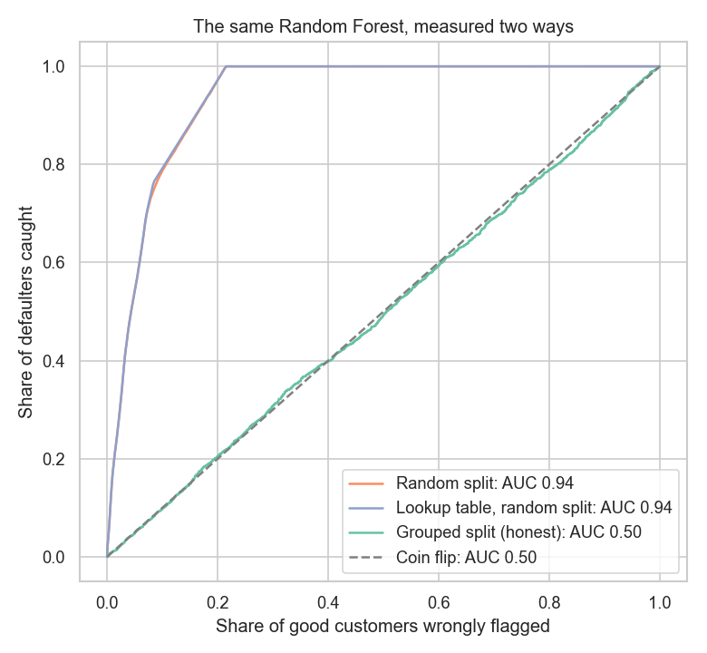
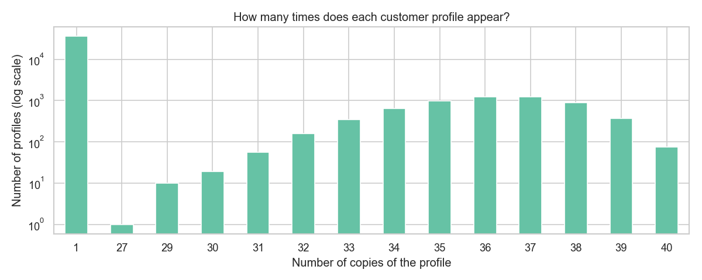

# Loan Default Prediction: The Score That Wasn't

A popular Kaggle dataset for predicting loan defaults gives models an outstanding score, **ROC AUC 0.94**. This project shows that the score is an illusion: **86% of the rows are copies**, the model only recognises customers it has already seen, and for genuinely new customers it is **no better than a coin flip** (AUC 0.50).

Data: [Kaggle – Loan Prediction Based on Customer Behavior](https://www.kaggle.com/datasets/subhamjain/loan-prediction-based-on-customer-behavior) (252,000 rows).



## Notebooks

| Notebook | What it covers |
|---|---|
| [01_exploration](notebooks/01_exploration.ipynb) | Imbalanced target and the accuracy trap, weak patterns, discovering the copies, other warning signs |
| [02_the_score_that_wasnt](notebooks/02_the_score_that_wasnt.ipynb) | ROC AUC and average precision, the inflated score, a lookup-table baseline, group-aware cross-validation, what it would mean for a bank |

## Key findings

**1. The 252,000 rows contain only 42,007 different customers.** 6,000 customer profiles are each copied 27 to 40 times, spread evenly through the file about every 5,400 rows. The other 36,007 appear once. No profile appears 2 to 26 times.



**2. A random split lets the model memorise.** With copies scattered over all folds, a Random Forest scores AUC 0.96 on customers whose twin was in training, and 0.49 on genuinely new customers.

**3. A lookup table does just as well.** A "model" that only looks up identical customers in the training data, knowing nothing about loans, scores the same AUC of 0.94.

**4. Measured honestly, nothing predicts default.**

| Evaluation | ROC AUC |
|---|---|
| Random split (the usual way) | 0.94 |
| Lookup table, random split | 0.94 |
| Copies kept together (`StratifiedGroupKFold`) | **0.50** |
| One row per customer, logistic regression / Random Forest | **0.51 / 0.50** |

**5. For a bank this would be costly.** The random-split evaluation suggests the bank could catch half of all defaulters while rejecting only 4% of good customers. In reality it would have to reject 51% of them, the same as tossing a coin.

**6. Even simple charts were distorted.** "Younger customers default more often" disappears once each customer is counted only once.

Other warning signs: no missing values at all, and 30 city names copied with Wikipedia footnote marks such as `Kota[6]`.

## How to catch this in your own projects

- Count duplicates **without** the ID column.
- Compare your model with a "dumb" baseline such as a lookup table.
- Be suspicious of scores far above what is typical in the field.
- Split the data the way the model will be used: keep all records of one customer together, or split by time for forecasts.

## How to run

1. Download `Training.csv` and `Test.csv` from [Kaggle](https://www.kaggle.com/datasets/subhamjain/loan-prediction-based-on-customer-behavior) into the `data/` folder.
2. Install the dependencies:
   ```bash
   pip install -r requirements.txt
   ```
3. Open the notebooks in `notebooks/` in VS Code or Jupyter and run them in order.

## Tools

Python · pandas · NumPy · Matplotlib · seaborn · scikit-learn · Jupyter
